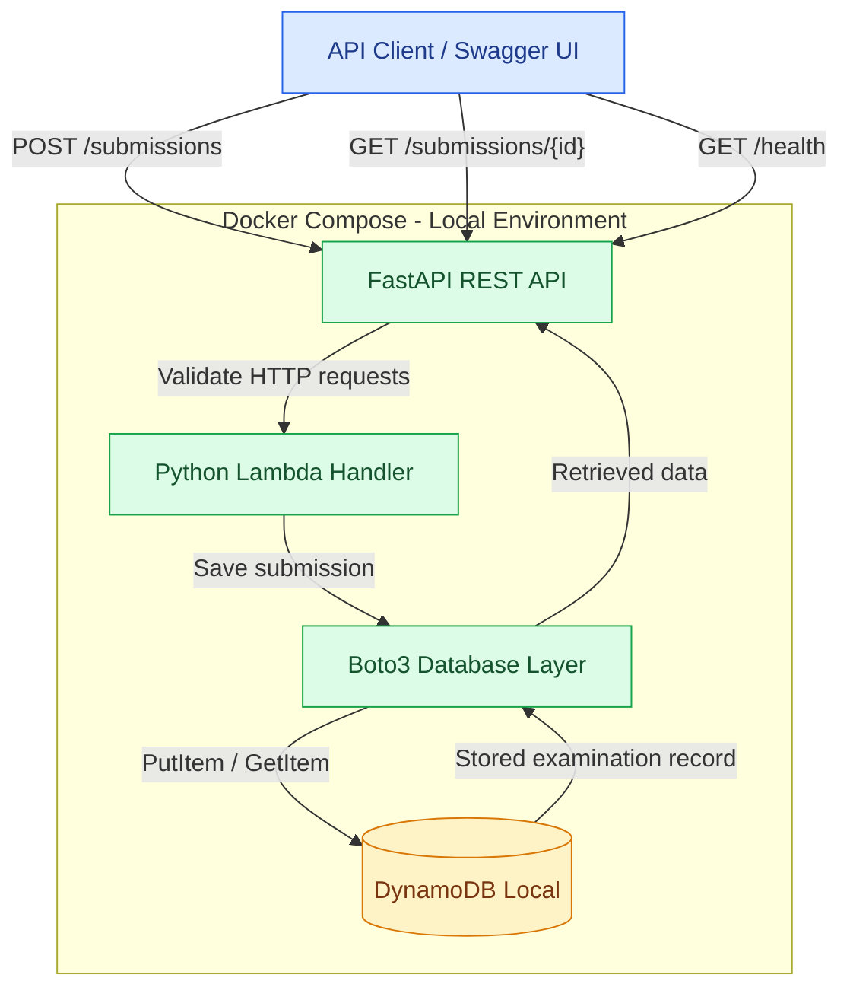
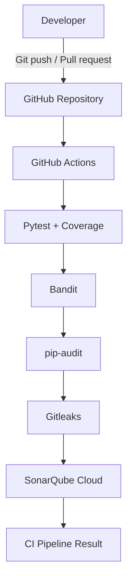

# CloudExam Architecture Diagram

## 1. Application Architecture

## 2. DevSecOps CI Pipeline

## 3. Technology Stack

- Python 3.13
- FastAPI
- Pydantic
- AWS SDK for Python (Boto3)
- DynamoDB Local
- Docker and Docker Compose
- GitHub Actions
- Pytest and pytest-cov
- Bandit
- pip-audit
- Gitleaks
- SonarQube Cloud

## 4. Deployment Scope

This is a local development prototype.

The application runs with Docker and DynamoDB Local. GitHub Actions executes CI checks using GitHub-hosted runners.

No production AWS infrastructure is deployed.
